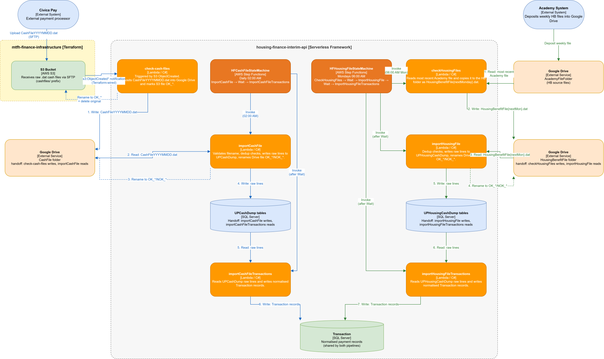

# Housing Finance Interim API

The Housing Finance Interim API is the London Borough of Hackney (LBH) **interim housing finance** service.
It exposes read/report endpoints over the finance database and hosts the scheduled **nightly finance
processing jobs** — importing cash files, housing benefit files, direct debits, charges, action diaries and
adjustments from Google Sheets/Drive and spreadsheets into SQL Server, refreshing balances, and generating
reports.

It runs as **one AWS Lambda** for the HTTP API plus a set of scheduled Lambda functions and step functions.

## Stack

- **.NET 10** (`net10.0`) — ASP.NET Core Web API hosted on **AWS Lambda** via `Amazon.Lambda.AspNetCoreServer`
  (the managed `dotnet10` runtime), with additional Lambda handlers for the scheduled jobs.
- **SQL Server** via **Entity Framework Core** and **EFCore.BulkExtensions**.
- **Google Drive / Google Sheets** APIs for spreadsheet ingestion.
- **Amazon S3** and **Amazon CloudWatch Logs**.
- **AutoMapper**, **Swashbuckle**, **FluentValidation**, **MVC API versioning**, **dotenv.net**.
- **AWS X-Ray** for tracing.
- **xUnit** + FluentAssertions/Moq/AutoFixture/Bogus for tests.

## Endpoints

All controller routes are hardcoded `api/v1/...` and are served as the default **v1.0** API version. Every
endpoint sits behind the API Gateway request authorizer (`[AuthorizeEndpointByGroups("HOUSING_FINANCE_ALLOWED_GROUPS")]`)
and API key.

| Verb | Route | Request → Response |
| --- | --- | --- |
| PATCH | `/api/v1/asset/{propertyReference}` | `UpdateAssetDetailsQuery` from the route + `UpdateAssetDetailsRequest` body (`PostPreamble`, `AddressLine1-4`, `PostCode`) → `204`, `400` (empty `AddressLine1`), `500` |
| GET | `/api/v1/batch/errors` | — → `200` `List<BatchLogResponse>` (`BatchId`, `ProcessName`, `StartTime`, `EndTime`, `Errors[]`), `404`, `500` |
| GET | `/api/v1/healthcheck/ping` | — → `200` `{ "success": true }` |
| GET | `/api/v1/healthcheck/error` | — → always throws (diagnostic endpoint) |
| GET | `/api/v1/nightly-process-status` | `createdDate` → `200` `List<NightlyProcessLogResponse>` (`Id`, `LogGroupName`, `Timestamp`, `IsSuccess`, `DateCreated`), `404`, `500` |
| GET | `/api/v1/operatingbalance` | `startDate`, `endDate`, `startWeek`, `startYear`, `endWeek`, `endYear` → `200` `List<OperatingBalance>`, `404` |
| GET | `/api/v1/payment` | `tenancyAgreementRef`, `rentAccount`, `householdRef`, `count`, `order` → `200` `List<Payment>` (`YearNo`, `PeriodNo`, `Amount`), `404` |
| POST | `/api/v1/report/charges` | `BatchReportChargesRequest` (`Year`, `RentGroup`, `Group`) → `201` `BatchReportChargesResponse` |
| GET | `/api/v1/report/charges` | — → `200` `List<BatchReportChargesResponse>` |
| POST | `/api/v1/report/operating-balances-by-rent-account` | `BatchReportOperatingBalancesByRentAccountRequest` (all required) → `201`, `400` |
| GET | `/api/v1/report/operating-balances-by-rent-account` | — → `200` `BatchReportOperatingBalancesByRentAccountResponse` |
| POST | `/api/v1/report/itemised-transactions` | `BatchReportItemisedTransactionRequest` (`Year`, `RentGroup`, `TransactionType`) → `201`, `400` |
| GET | `/api/v1/report/itemised-transactions` | — → `200` `BatchReportItemisedTransactionResponse` |
| POST | `/api/v1/report/cash/suspense` | `BatchReportCashSuspenseRequest` (`Year`, `SuspenseAccountType`) → `201` |
| GET | `/api/v1/report/cash/suspense` | — → `200` `BatchReportCashSuspenseResponse` |
| POST | `/api/v1/report/cash/import` | `BatchReportCashImportRequest` (`StartDate`, `EndDate`) → `201` |
| GET | `/api/v1/report/cash/import` | — → `200` `BatchReportCashImportResponse` |
| POST | `/api/v1/report/balance` | `BatchReportAccountBalanceRequest` (`RentGroup`, `ReportDate`) → `201` |
| GET | `/api/v1/report/balance` | — → `200` `BatchReportAccountBalanceResponse` |
| POST | `/api/v1/report/housingbenefit/academy` | `BatchReportHousingBenefitAcademyRequest` (`Year`) → `201` |
| GET | `/api/v1/report/housingbenefit/academy` | — → `200` `BatchReportHousingBenefitAcademyResponse` |
| GET | `/api/v1/tenancy` | `tenancyAgreementRef`, `rentAccount`, `householdRef` → `200` `Tenancy`, `404` |
| GET | `/api/v1/tenancy/transaction` | `tenancyAgreementRef`, `rentAccount`, `householdRef`, `count`, `order`, `startDate`, `endDate` → `200` `List<TenancyTransaction>`, `404` |
| GET | `/api/v1/transaction/summary` | `startDate`, `endDate` → `200` `List<Transaction>`, `404` |
| GET | `/swagger/{proxy+}` | Swagger UI / OpenAPI document (unauthenticated) |

## Scheduled jobs

The scheduled Lambda functions and step functions are declared in `HousingFinanceInterimApi/serverless.yml`
and implemented in `HousingFinanceInterimApi/Handler.cs`. All cron triggers are governed by the
`custom.schedulesEnabled` flag (`false`), which is why the individual `schedule` events are disabled by
default.

**Functions:** `loadTenancyAgreement` (00:00), `importCashFile`, `importCashFileTransactions`,
`checkCashFiles`, `checkHousingFiles`, `importHousingFile`, `importHousingFileTransactions`,
`refreshCurrentBalance`, `refreshOperatingBalance` (06:45), `refreshManageArrearsTables`,
`importDirectDebit`, `importDirectDebitTransactions`, `importDirectDebitTransactionsOnDemand`,
`checkChargesBatchYears`, `importCharges`, `importChargesHistory`, `importChargesTransactions`,
`importChargesTransactionsOnDemand`, `loadActionDiary` (03:00), `generateRentPosition` (07:15),
`importAdjustmentsTransactions` (02:45), `suspenseCash` (03:05), `suspenseHousingBenefit` (03:10),
`generateReport`, `parseNightlyProcessLogs` (07:30).

**Step functions:** `HFCashFileStateMachine` (02:00 daily), `HFHousingFileStateMachine` (06:00 Mondays),
`HFDirectDebitStateMachine` (02:30 daily), `HFCurrentBalanceStateMachine` (06:10 daily) and
`HFReportsStateMachine` (every 30 minutes — the one schedule that is **not** gated by `schedulesEnabled`).
Each Task state retries `States.All` three times with a backoff rate of 2.

### Known limitations

- The management-fee branch of `ApplyHeadOfChargeUseCase` throws `NotImplementedException`
  (`ManagementFeeUseCase`, `ChargesMaintenanceApiGateway`, `Infrastructure/UpdateAssetSummary`).
- The `importCashFileTransactions` / `importHousingFileTransactions` step responses share a process-wide
  `WAIT_DURATION` environment variable, which makes some `NextStepTime` unit-test assertions order-dependent.
- `AutoMapper` is referenced and mapping profiles exist, but `AddAutoMapper` is never called, so the mapper is
  not registered in DI.
- `Microsoft.AspNetCore.HealthChecks` 1.0.0 is referenced but the only consumer (`DbHealthCheckUseCase`) is
  not registered, and no health-checks middleware is wired up.

## Data sources and external dependencies

| Dependency | Detail |
| --- | --- |
| **SQL Server** | The single primary datastore. The connection string comes from the `CONNECTION_STRING` environment variable (SSM per stage in Lambda; `.env` locally; `finance_database.mk` generates one for the port-forwarded dev database). |
| Entities / tables | `BatchLog`, `BatchLogError`, `ChargesBatchYears`, `GoogleFileSetting`, `UPCashDumpFileName`, `UPCashDump`, `UPHousingCashDumpFileName`, `UPHousingCashDump`, `ErrorLog`, `SSRentBreakdown`, `SSCurrentRentPosition`, `SSServiceChargePaymentsReceived`, `SSLeaseholdAccount`, `SSGarage`, `SSOtherHRA`, `SuspenseTransaction`, `SuspenseTransactionAux`, `ReportCashSuspenseAccount`, `ReportCashImport`, `BatchReport`, `ReportAccountBalance`, `NightlyProcessLog`, `ChargesAux`, `DirectDebitAux`, `ActionDiaryAux`, `AdjustmentAux`, `TenancyAgreementAux`, plus keyless views for `OperatingBalance`, `Payment`, `Tenancy`, `TenancyTransaction`, `Transaction` and `PRNTransactionEntity`. |
| Stored procedures | ~50, e.g. `usp_GetOperatingBalancesByRentGroup`, `usp_UpdateAssetDetails`, `usp_GetTenancyTransactions[ByDate]`, `usp_RefreshManageArrears{Member,Property}`, `usp_GetTransactions`, `usp_Load*` (13), `usp_GetCashSuspenseAccountByYear`, `usp_GetReportAccountBalance`. The real schema lives in the database — `database/schema.sql` is only a 4-line stub used to initialise the test container. |
| **Google Drive / Google Sheets** | Credentials from `GOOGLE_API_KEY` (the service-account JSON) in SSM; scopes `DriveService.Scope.Drive` and `SheetsService.Scope.SpreadsheetsReadonly`. Spreadsheet and folder IDs are not in code — they come from the `GoogleFileSetting` table (`GoogleIdentifier`, `FileType`, `Label`, `FileYear`, `StartDate`, `EndDate`). |
| **Amazon S3** | `S3_BUCKET_NAME` and `S3_OBJECT_PREFIX` from SSM. Used to list, download, copy (`OK_`/`NOK_` prefixes) and delete cash/housing-benefit files. |
| **Amazon CloudWatch Logs** | `services.AddAWSService<IAmazonCloudWatchLogs>()`; nightly-process log groups (17, built from `ENVIRONMENT_NAME`) are queried and the results persisted to `NightlyProcessLog`. |
| **SNS** | Per-Lambda error alarms and spreadsheet-error metric filters publish to the `housing-finance-alarms` topic. |
| **AWS SSM Parameter Store** | DB host/port/database/username/password, Google credentials, wait duration, batch size, file regexes, accepted origins, charges batch years, S3 bucket/prefix and allowed groups — all under `/housing-finance/{stage}/...`. |
| **AWS X-Ray** | Tracing on the API and the scheduled functions. |
| PostgreSQL / DynamoDB | **Not used.** The earlier README (and a few settings) referred to PostgreSQL; the datastore is SQL Server. `database.env` configures the SQL Server test container. |

## Development

### Requirements

1. [Docker][docker-download] with the **`docker compose`** v2 plugin.
2. A recent version of [AWS CLI V2][aws-cli].
3. An AWS CLI profile for an environment the Finance DB is deployed in.
4. A recent version of the [Session Manager Plugin][session-manager-install] for the AWS CLI.
5. A **`LBHPACKAGESTOKEN`** with `read:packages` access to the `LBHackney-IT` GitHub Packages feed — the
   `Hackney.*` packages are not published to nuget.org:
   ```sh
   export LBHPACKAGESTOKEN=<token>
   ```
6. Copy [`.env.sample`](.env.sample) to `.env` and fill in the values. This is the supported local
   configuration path: `docker compose` interpolates every runtime variable from it, and a local Debug build
   (`make serve-local`) loads it directly via dotenv.net. See [Environment variables](#environment-variables)
   below.

On Windows:
- You will need to use Git Bash or Windows Subsystem for Linux to run the Make commands.
- To run with Docker you will need Windows Subsystem for Linux v2 with Docker Engine installed on it (NOT
  Docker Desktop on base Windows — this [does not support the host networking driver][host-networking-prereq]).

On macOS (Monterey — possibly others):
- You will need to [turn off the AirPlay receiver](https://developer.apple.com/forums/thread/682332) from your
  sharing settings due to a port 5000 conflict.

### Environment variables

- See the [Serverless configuration](HousingFinanceInterimApi/serverless.yml) `environment` block for the
  variables that are set from Parameter Store.
- Copy [`.env.sample`](.env.sample) into the same directory, rename it to `.env`, then set the values.
- Pay particular attention to `GOOGLE_API_KEY`, which must be JSON wrapped in single quotes and on a single line.

### Port forwarding to the finance DB

This is required to connect the API to a functional database locally.

1. Open the [finance_database.mk](finance_database.mk) Makefile, which contains the port-forwarding commands.
2. There is a helper that generates the connection string for a given AWS profile — run it and copy the output
   into your `.env`:
   ```sh
   make -f finance_database.mk local_connection_string_to_env
   ```
3. Ensure you have an AWS CLI profile (default `housing-{stage}`) matching the `PROFILE` variable and the same
   profile the credentials were sourced from.
4. Edit the file to use the correct stage (development / staging / production).
5. If you use an SSO profile, refresh your login with:
   ```sh
   make -f finance_database.mk sso_login
   ```
6. Start the port forwarding:
   ```sh
   make -f finance_database.mk port_forwarding_to_hfs_db
   ```

#### Connecting with a local client (optional)

- Connect to `localhost` on port `1433`.
- Use the username and password printed to the console after the port forwarding starts.

### Running with Docker

`docker compose` reads the `.env` file in the root directory and connects to the port-forwarded database on
`localhost:1433` using host networking.

On Windows you need Docker Desktop running with WSL2 integration enabled.

From the root directory:

```sh
make build && make serve
```

### Running locally without Docker

The application loads the `.env` file in the root directory and connects to the port-forwarded database on
`localhost:1433`:

```sh
make serve-local
# or
dotnet run --project HousingFinanceInterimApi/HousingFinanceInterimApi.csproj
```

You can also configure your IDE of choice to run the `HousingFinanceInterimApi` project.

## Testing

```sh
make test
```

`make test` builds the test image (`HousingFinanceInterimApi.Tests/Dockerfile`) and runs the xUnit suite
inside it against the `test-database` SQL Server container from `docker-compose.yml`.

- The suite is **xUnit-only** (with FluentAssertions, Moq, AutoFixture and Bogus).
- Database-backed tests use the `DB_SERVER` / `DB_USERNAME` / `DB_PASSWORD` / `DB_DATABASE` environment
  variables supplied by `docker-compose.yml` and call `EnsureCreated()` against the stub database.
- `MockWebApplicationFactory`/`IntegrationTests` are present but their integration-test bodies are commented
  out.
- If the database schema changes, remove and recreate the database image (the `restart-db` make target does
  this).
- The `BaseApi.Tests` folder contains only a leftover `launchSettings.json`; it is not a project, is not in the
  solution and is not built.

### Agreed testing approach

- Use xUnit, FluentAssertions and Moq.
- Follow a TDD approach; keep tests independent of each other.
- Gateway tests interact with a real test instance of the database.
- Test coverage should never go down.
- All use cases should be covered by E2E tests.
- Unit and E2E tests run in CI.
- Test database schemas should match the production database schema.

## Architecture

### File processing pipeline

The diagram below shows how cash files and housing benefit files flow through the system (C4 Container view).



This diagram is editable, in case the process changes in the future.

## Deployment

Deployment is via the **Serverless Framework** from CircleCI (`.circleci/config.yml`). This repository has **no
Terraform** — the Lambda, its schedules and its IAM resources are declared in `serverless.yml`'s `resources:`
block. CI gates deployment on a code-formatting check (`dotnet-format --check`) and the Docker test suite.
Changes are reviewed and approved on a branch before merging.

**Stages and triggers:**

- **Any branch** — formatting check and tests.
- **`development`** — after the checks pass, the function is deployed to **development**.
- **`master`** — tests, then deployment to **staging**, then (after the `permit-production-release` manual
  approval) deployment to **production**.

Note that the development deployment is driven by the `development` branch, and that this repository has **no
pre-production stage**.

**Packaging and runtime:**

- `build.sh` installs `Amazon.Lambda.Tools` and runs
  `dotnet lambda package --configuration release --framework net10.0 --output-package ./bin/release/net10.0/housing-finance-interim-api.zip`.
  (`build.cmd` is the Windows equivalent for local use.)
- The deploy job runs `sls deploy --stage <stage>`.
- `serverless.yml` declares `runtime: dotnet10` and consumes that artifact; it declares the HTTP API plus the
  25 scheduled functions and 5 step functions described above.

## Data migrations

### A good data migration

- Record failure logs.
- Automated.
- Reliable.
- As close to real time as possible.
- Observable monitoring in place.
- Should not affect any existing databases.

## Contacts

**Housing product team** — [mmh-project-team@hackney.gov.uk](mailto:mmh-project-team@hackney.gov.uk)

[docker-download]: https://www.docker.com/products/docker-desktop
[aws-cli]: https://aws.amazon.com/cli/
[session-manager-install]: https://docs.aws.amazon.com/systems-manager/latest/userguide/session-manager-working-with-install-plugin.html
[host-networking-prereq]: https://docs.docker.com/network/network-tutorial-host/#prerequisites
