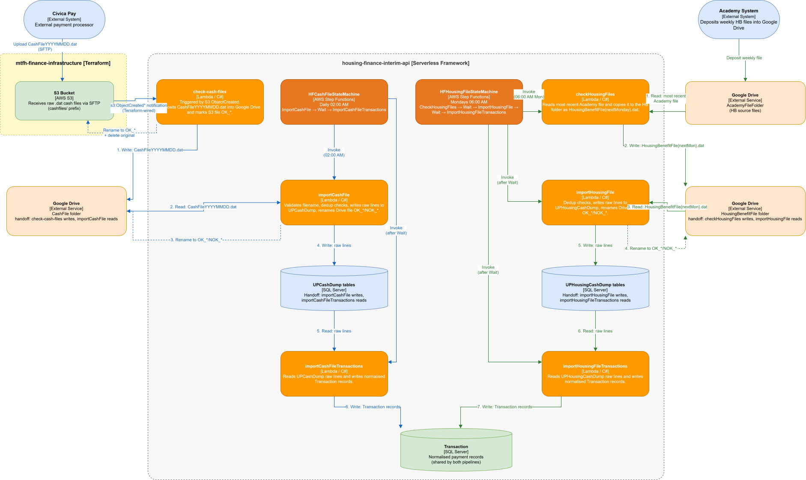
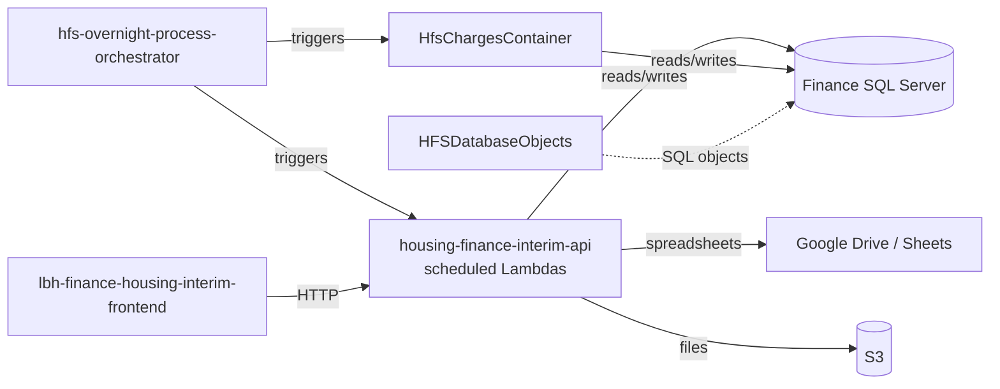

# Housing Finance Interim API

The Housing Finance Interim API is the London Borough of Hackney (LBH) **interim housing finance** service.
It exposes read/report endpoints over the finance database and hosts most of the scheduled **nightly finance
processing jobs** — importing cash files, housing benefit files, direct debits, charges, action diaries and
adjustments from Google Sheets/Drive and spreadsheets into SQL Server, refreshing balances, and generating
reports.

It deploys one AWS Lambda for the HTTP API plus a set of scheduled Lambda functions and step functions.

## Tech stack

| Area | Technology |
| --- | --- |
| Runtime | **.NET 10** (`net10.0`), ASP.NET Core Web API plus additional Lambda handlers for the scheduled jobs |
| Hosting | **AWS Lambda** (`dotnet10` managed runtime) via `Amazon.Lambda.AspNetCoreServer` for the API, and scheduled Lambda functions driven by **Step Functions**, in AWS region `eu-west-2` |
| API layer | Amazon **API Gateway** (`ANY /{proxy+}`) behind a request authorizer and the `Platform_APIs_Web_ACL` WAF |
| Datastore | **SQL Server** via **Entity Framework Core** and **EFCore.BulkExtensions** |
| External data | **Google Drive / Google Sheets** APIs for spreadsheet ingestion, **Amazon S3** for cash/housing-benefit files, **Amazon CloudWatch Logs** for nightly-process logs |
| Infrastructure | Declared in [`HousingFinanceInterimApi/serverless.yml`](HousingFinanceInterimApi/serverless.yml) `resources:` block — this repository has **no Terraform** |
| Deployment | **Serverless Framework** driven by **CircleCI** |
| Observability | **AWS X-Ray** tracing, structured logging, **SNS** error alarms and spreadsheet-error metric filters |
| API docs | **Swashbuckle** (Swagger/OpenAPI) |
| Cross-cutting | `Hackney.Core.*` packages (authorization, HTTP, JWT), **FluentValidation**, **MVC API versioning**, **dotenv.net** for local `.env` loading, **AutoMapper** (referenced, but not registered in DI) |
| Testing | xUnit, FluentAssertions, Moq, AutoFixture, Bogus |

## Endpoints

All controller routes are hardcoded `api/v1/...` and are served as the default **v1.0** API version. Every
endpoint sits behind the API Gateway request authorizer
(`[AuthorizeEndpointByGroups("HOUSING_FINANCE_ALLOWED_GROUPS")]`) and API key, except the (unauthenticated)
Swagger route.

| Verb | Route | Request (model) | Response (model) | Summary |
| --- | --- | --- | --- | --- |
| PATCH | `/api/v1/asset/{propertyReference}` | `UpdateAssetDetailsQuery` from the route + `UpdateAssetDetailsRequest` body (`PostPreamble`, `AddressLine1-4`, `PostCode`) | `204 No Content`, `400` (empty `AddressLine1`), `500` | Updates the stored address details of an asset identified by property reference. |
| GET | `/api/v1/batch/errors` | — | `200 OK` → `List<BatchLogResponse>` (`BatchId`, `ProcessName`, `StartTime`, `EndTime`, `Errors[]`), `404`, `500` | Lists the batch import runs and the errors recorded against each. |
| GET | `/api/v1/healthcheck/ping` | — | `200 OK` → `{ "success": true }` | Liveness/readiness probe. |
| GET | `/api/v1/healthcheck/error` | — | always throws | Diagnostic endpoint used to exercise the error pipeline and alarms. |
| GET | `/api/v1/nightly-process-status` | `createdDate` | `200 OK` → `List<NightlyProcessLogResponse>` (`Id`, `LogGroupName`, `Timestamp`, `IsSuccess`, `DateCreated`), `404`, `500` | Returns the success/failure log of the nightly processes for the given date, read from CloudWatch Logs. |
| GET | `/api/v1/operatingbalance` | `startDate`, `endDate`, `startWeek`, `startYear`, `endWeek`, `endYear` | `200 OK` → `List<OperatingBalance>`, `404` | Returns operating balances for the requested date/week range. |
| GET | `/api/v1/payment` | `tenancyAgreementRef`, `rentAccount`, `householdRef`, `count`, `order` | `200 OK` → `List<Payment>` (`YearNo`, `PeriodNo`, `Amount`), `404` | Returns rent payment periods for a tenancy, account or household. |
| POST | `/api/v1/report/charges` | `BatchReportChargesRequest` (`Year`, `RentGroup`, `Group`) | `201 Created` → `BatchReportChargesResponse` | Generates the charges report for the requested year/rent group/group. |
| GET | `/api/v1/report/charges` | — | `200 OK` → `List<BatchReportChargesResponse>` | Returns the generated charges reports. |
| POST | `/api/v1/report/operating-balances-by-rent-account` | `BatchReportOperatingBalancesByRentAccountRequest` (all fields required) | `201 Created`, `400` | Generates the operating-balances-by-rent-account report. |
| GET | `/api/v1/report/operating-balances-by-rent-account` | — | `200 OK` → `BatchReportOperatingBalancesByRentAccountResponse` | Returns the generated operating-balances-by-rent-account report. |
| POST | `/api/v1/report/itemised-transactions` | `BatchReportItemisedTransactionRequest` (`Year`, `RentGroup`, `TransactionType`) | `201 Created`, `400` | Generates the itemised-transactions report. |
| GET | `/api/v1/report/itemised-transactions` | — | `200 OK` → `BatchReportItemisedTransactionResponse` | Returns the generated itemised-transactions report. |
| POST | `/api/v1/report/cash/suspense` | `BatchReportCashSuspenseRequest` (`Year`, `SuspenseAccountType`) | `201 Created` | Generates the cash-suspense report. |
| GET | `/api/v1/report/cash/suspense` | — | `200 OK` → `BatchReportCashSuspenseResponse` | Returns the generated cash-suspense report. |
| POST | `/api/v1/report/cash/import` | `BatchReportCashImportRequest` (`StartDate`, `EndDate`) | `201 Created` | Generates the cash-import report. |
| GET | `/api/v1/report/cash/import` | — | `200 OK` → `BatchReportCashImportResponse` | Returns the generated cash-import report. |
| POST | `/api/v1/report/balance` | `BatchReportAccountBalanceRequest` (`RentGroup`, `ReportDate`) | `201 Created` | Generates the account-balance report. |
| GET | `/api/v1/report/balance` | — | `200 OK` → `BatchReportAccountBalanceResponse` | Returns the generated account-balance report. |
| POST | `/api/v1/report/housingbenefit/academy` | `BatchReportHousingBenefitAcademyRequest` (`Year`) | `201 Created` | Generates the housing-benefit Academy report. |
| GET | `/api/v1/report/housingbenefit/academy` | — | `200 OK` → `BatchReportHousingBenefitAcademyResponse` | Returns the generated housing-benefit Academy report. |
| GET | `/api/v1/tenancy` | `tenancyAgreementRef`, `rentAccount`, `householdRef` | `200 OK` → `Tenancy`, `404` | Returns the tenancy for the supplied agreement reference, rent account or household reference. |
| GET | `/api/v1/tenancy/transaction` | `tenancyAgreementRef`, `rentAccount`, `householdRef`, `count`, `order`, `startDate`, `endDate` | `200 OK` → `List<TenancyTransaction>`, `404` | Returns the transactions for a tenancy within the requested range. |
| GET | `/api/v1/transaction/summary` | `startDate`, `endDate` | `200 OK` → `List<Transaction>`, `404` | Returns transaction summaries for the requested date range. |
| GET | `/swagger/{proxy+}` | — | OpenAPI document / Swagger UI | Interactive API documentation (unauthenticated). |

## Scheduled jobs

The scheduled Lambda functions and step functions are declared in
[`HousingFinanceInterimApi/serverless.yml`](HousingFinanceInterimApi/serverless.yml) and implemented in
`HousingFinanceInterimApi/Handler.cs`. All cron triggers are governed by the `custom.schedulesEnabled` flag
(`false`), which is why the individual `schedule` events are disabled by default.

These scheduled jobs are triggered by the
[hfs-overnight-process-orchestrator](https://github.com/LBHackney-IT/hfs-overnight-process-orchestrator).
See that repository's README for the sequence and functionality.

### File processing pipeline

The diagram below shows how cash files and housing benefit files flow through the system (C4 Container view).

This diagram is editable, in case the process changes in the future.

## Related repositories

This service is the core of the Housing Finance System (HFS) interim capability. The overnight processes it
hosts are orchestrated by a separate service, its database objects live in their own repository, and the
charges import has been split out because it exceeds the Lambda execution limit.

| Repository | Summary |
| --- | --- |
| [housing-finance-interim-api](https://github.com/LBHackney-IT/housing-finance-interim-api) | **Serves the finance API and hosts the nightly jobs.** This repository — HTTP read/report endpoints over the finance database plus the scheduled Lambda functions and step functions. |
| [hfs-overnight-process-orchestrator](https://github.com/LBHackney-IT/hfs-overnight-process-orchestrator) | **Triggers the nightly jobs.** An AWS ECS Fargate orchestrator that runs the overnight processes hosted here in the correct sequence. |
| [HfsChargesContainer](https://github.com/LBHackney-IT/HfsChargesContainer) | **Runs the charges import.** The charges-import nightly process that was moved out of this repository because it exceeded the 15-minute Lambda limit; it now runs on ECS Fargate from the same cron expression. |
| [HFSDatabaseObjects](https://github.com/LBHackney-IT/HFSDatabaseObjects) | **Defines the database logic.** Version-controlled SQL functions and stored procedures for the finance database, with their unit tests. |

## Data sources and external dependencies

| Source | Summary |
| --- | --- |
| **SQL Server** | The single primary datastore. The connection string comes from the `CONNECTION_STRING` environment variable (SSM per stage in Lambda; `.env` locally; `finance_database.mk` generates one for the port-forwarded dev database). |
| **Google Drive / Google Sheets** | Credentials from `GOOGLE_API_KEY` (the service-account JSON) in SSM; scopes `DriveService.Scope.Drive` and `SheetsService.Scope.SpreadsheetsReadonly`. Spreadsheet and folder IDs are not in code — they come from the `GoogleFileSetting` table (`GoogleIdentifier`, `FileType`, `Label`, `FileYear`, `StartDate`, `EndDate`). |
| **Amazon S3** | `S3_BUCKET_NAME` and `S3_OBJECT_PREFIX` from SSM. Used to list, download, copy (`OK_`/`NOK_` prefixes) and delete cash/housing-benefit files. |
| **Amazon CloudWatch Logs** | `services.AddAWSService<IAmazonCloudWatchLogs>()`; the nightly-process log groups (17, built from `ENVIRONMENT_NAME`) are queried and the results persisted to `NightlyProcessLog`. |
| **SNS** | Per-Lambda error alarms and spreadsheet-error metric filters publish to the `housing-finance-alarms` topic. |
| **AWS SSM Parameter Store** | DB host/port/database/username/password, Google credentials, wait duration, batch size, file regexes, accepted origins, charges batch years, S3 bucket/prefix and allowed groups — all under `/housing-finance/{stage}/...`. |
| **Amazon API Gateway** | Fronts the API Lambda behind the request authorizer and the `Platform_APIs_Web_ACL` WAF. |
| **AWS X-Ray** | Tracing on the API and the scheduled functions. |
| **AWS region** | `eu-west-2` throughout. |

## Contributing

Local setup (including port forwarding to the finance database), build, run, test and deployment instructions
live in [CONTRIBUTION.md](CONTRIBUTION.md).

## Contacts

**Housing product team** — [mmh-project-team@hackney.gov.uk](mailto:mmh-project-team@hackney.gov.uk)
